<!--
  README of @mahedi0x · Mahedi Hasan

  Every card is a plain SVG in assets/, built by a script next to it:
    hero.svg, now.svg, neofetch-card.svg, orbit.svg, footer.svg   python assets/build.py
    stats-card.svg                                                python assets/stats.py  (auto-refreshed daily by .github/workflows/stats.yml)
  The snake comes from .github/workflows/snake.yml (branch "output").
-->

<p align="center">
  
</p>

<p align="center">
  <a href="https://www.linkedin.com/in/mahedi0x/"></a>
  <a href="https://www.facebook.com/mahdihasan.sun"></a>
  <a href="mailto:mahedi.swe04@gmail.com"></a>
  <a href="https://github.com/mahedi0x"></a>
</p>

<p align="center">
  
  <a href="https://github.com/mahedi0x?tab=followers"></a>
  <a href="https://github.com/mahedi0x?tab=repositories"></a>
</p>

---

## <samp>&gt;&nbsp;About Me</samp>

<p align="center">
  
</p>

I'm **Mahedi Hasan** (`mahedi0x`), a passionate **Full Stack Developer** who loves crafting dynamic,
user-friendly and scalable digital experiences. I enjoy solving real-world problems using clean
architecture and modern technologies.

- ⚛️ &nbsp;I build interfaces with **React, Next.js and Tailwind CSS**
- 🟢 &nbsp;I write backends and APIs with **Node.js, Python and PHP**
- 🗄️ &nbsp;I work with **MySQL** for data
- 🤖 &nbsp;Learning **Machine Learning** to integrate AI into web apps
- 🔐 &nbsp;Improving my **advanced security practices**
- 🧩 &nbsp;Sharpening my **Data Structures & Algorithms**
- ✨ &nbsp;I love exploring new tools and coding patterns, and breaking complex ideas into simple solutions
- 📫 &nbsp;Reach me at **mahedi.swe04@gmail.com**

<details>
<summary><samp><b>&nbsp;⚡ mahedi.js: run me</b></samp></summary>

```javascript
const mahedi = {
  name: "Mahedi Hasan",
  handle: "mahedi0x",
  role: "Full Stack Web Developer",
  frontend: ["React", "Next.js", "Tailwind CSS", "HTML", "CSS", "JavaScript"],
  backend: ["Node.js", "Python", "PHP"],
  database: ["MySQL"],
  learning: ["Machine Learning", "Web Security", "DSA"],
  portfolio: "coming soon...",

  sayHello() {
    return `Hi, I'm ${this.name}. Let's build something together!`;
  },
};

console.log(mahedi.sayHello());
```

</details>

---

## <samp>&gt;&nbsp;Right Now</samp>

<p align="center">
  
</p>

---

## <samp>&gt;&nbsp;What I Do</samp>

<table align="center">
<tr align="center">
<td width="25%">

### 🎨
**Frontend**

Responsive, user-friendly interfaces with React, Next.js and Tailwind CSS.

</td>
<td width="25%">

### 🔌
**Backend & APIs**

Server logic and REST APIs with Node.js, Python and PHP on top of MySQL.

</td>
<td width="25%">

### 🤖
**AI for the Web**

Learning Machine Learning to bring smart features into web apps.

</td>
<td width="25%">

### 🧠
**Problem Solving**

Clean architecture, secure code and steady DSA practice.

</td>
</tr>
</table>

---

## <samp>&gt;&nbsp;Tech Stack</samp>

<p align="center">
  
</p>

<details>
<summary><samp><b>&nbsp;📋 the same stack as a list</b></samp></summary>
<br>

<table align="center">
  <tr>
    <td align="right" width="130"><b>Languages</b></td>
    <td></td>
  </tr>
  <tr>
    <td align="right"><b>Frameworks</b></td>
    <td></td>
  </tr>
  <tr>
    <td align="right"><b>Database</b></td>
    <td></td>
  </tr>
  <tr>
    <td align="right"><b>Tools</b></td>
    <td></td>
  </tr>
</table>

</details>

---

## <samp>&gt;&nbsp;GitHub Activity</samp>

<!--
  Self-hosted on purpose: the free Vercel cards (github-readme-stats and friends)
  often answer 402 or 503. Refreshed daily by .github/workflows/stats.yml.
-->
<p align="center">
  
</p>

<p align="center">
  <picture>
    <source media="(prefers-color-scheme: dark)" srcset="https://raw.githubusercontent.com/mahedi0x/mahedi0x/output/github-snake-dark.svg">
    <source media="(prefers-color-scheme: light)" srcset="https://raw.githubusercontent.com/mahedi0x/mahedi0x/output/github-snake.svg">
    
  </picture>
</p>

<!--
---

## <samp>&gt;&nbsp;Featured Projects</samp>

  Uncomment this section and fill in your own projects (copy a <td> block for more).

<table>
<tr>
<td width="50%" valign="top">

### 🚀 Project Name


One or two lines on what it does and who it's for.

`React` `Node.js` `MySQL`

<a href="LIVE_URL"></a>
<a href="REPO_URL"></a>

</td>
<td width="50%" valign="top">

### 🛒 Project Name


One or two lines on what it does and who it's for.

`Next.js` `Tailwind CSS` `PHP`

<a href="LIVE_URL"></a>
<a href="REPO_URL"></a>

</td>
</tr>
</table>
-->

---

## <samp>&gt;&nbsp;Get in Touch</samp>

<div align="center">

**Always happy to talk about web development, collaboration or anything code.**

<a href="mailto:mahedi.swe04@gmail.com"></a>
<a href="https://www.linkedin.com/in/mahedi0x/"></a>

<br><br>

<samp><i>"Break complex ideas into simple solutions."</i></samp>

</div>

<p align="center">
  
</p>
